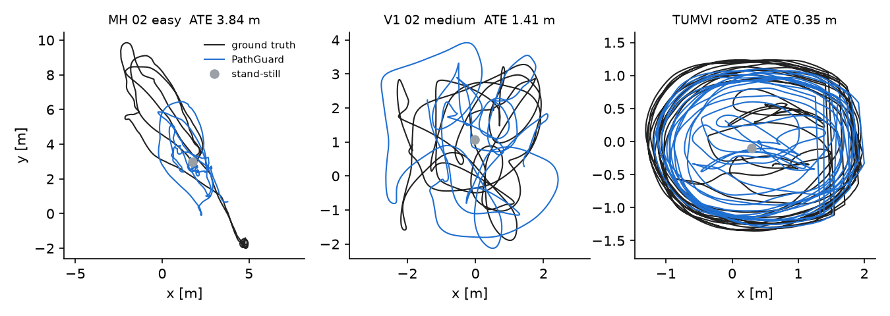
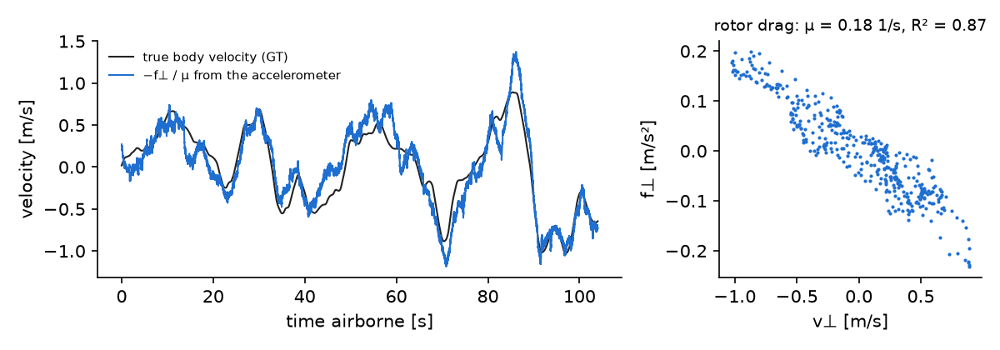
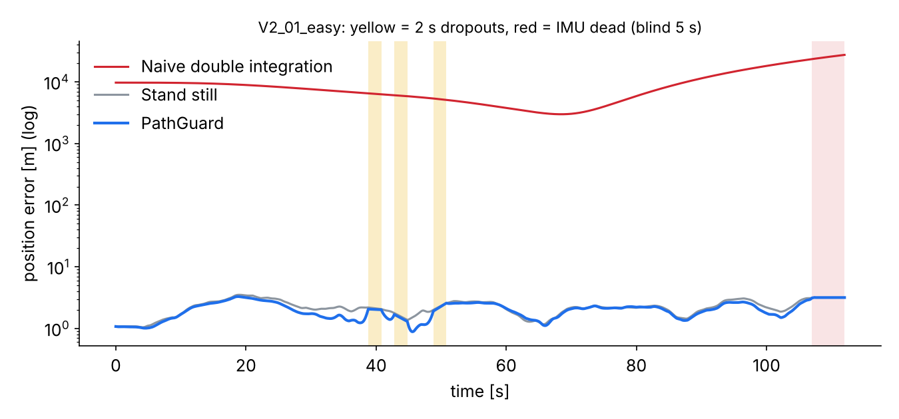

# PathGuard

**IMU-only 6-DoF trajectory estimation under progressive sensor degradation.**
Samsung PRISM XR Hackathon 2026 · Track 03 · Path Finder: Trajectory Estimation Under Sensor Degradation
Team **ashdev7** · Thapar Institute of Engineering and Technology, Patiala · Yash Tyagi

PathGuard turns a degraded IMU log (EuRoC `imu0/data.csv`) into a 6-DoF trajectory with exactly one pose per
IMU row, including the 5 s after the IMU fails. The whole estimator is one **pure-Python, standard-library-only**
file, [`src/main.py`](src/main.py): no numpy, no compiled code, nothing to install.

On real EuRoC and TUM-VI IMU data degraded by the organizers' own script, on flights never used for tuning:

| | PathGuard | standing still | naive double integration |
|---|---|---|---|
| Drone (6 EuRoC flights): ATE | **2.37 m** | 3.20 m | 18,645 m |
| Drone: blind 5 s after failure | **2.21 m** | 2.89 m | 41,282 m |
| Handheld (3 TUM-VI rooms): ATE | **0.53 m** | 1.10 m | 644 m |
| Runtime / estimator heap | **6.2–6.9 ms per 1 s of IMU / 1.7–1.9 MB** | budget: 20 ms / 8 MB | |



## Quick start

```bash
python src/main.py path/to/imu0/data.csv estimated_trajectory.txt     # a CSV, a dataset folder or a .zip
python src/main.py sample/imu0/data.csv out.txt --verbose=1             # diagnostics on stderr

docker build -t pathguard src/
docker run --rm -v "$PWD/sample:/data" pathguard /data/imu0/data.csv /data/estimated_trajectory.txt
```

Python ≥ 3.8 (CI runs 3.8–3.13 and the Docker build on every push). Single thread, offline.
`--verbose=1` prints the detected platform, the estimated jamming level and the integrity statistics.

## Output contract

- `estimated_trajectory.txt`, space separated: `timestamp tx ty tz qx qy qz qw`, header line starting with `#`.
- Exactly one pose per input row, in input order, including duplicated rows and the dead rows after the
  failure. Nothing is appended (organizer FAQ).
- Timestamps are the input nanoseconds converted to seconds by integer arithmetic (no float rounding).
- Unit quaternions (scalar last), body to world, world z up (gravity), `qw ≥ 0`.
- Header, column order (gyro/accel), timestamp unit and accelerometer unit (m/s² or g) are detected.
- Any input, however broken (empty, a few rows, garbage values, out-of-order timestamps), yields a
  well-formed file; if estimation cannot run, a stand-still trajectory is written.
  `tests/test_contract.py` checks 18 input variants.

## How it works

```
imu0/data.csv
 │  pass 1 (stream)  format survey; integrity: NaN, dead (all-zero), frozen and duplicated rows, six-channel spikes;
 │                   jamming meter: packet loss → severity s(t), per-second noise levels;
 │                   preintegration into 20 ms bins; 0.5 s rest statistics
 ├─ platform         rotor-vibration signature → drone or handheld motion prior
 ├─ attitude         error-state Kalman filter [δθ (world frame), gyro bias] + error-state RTS smoother;
 │                   gravity-direction updates (roll/pitch), zero-angular-rate updates at rest
 ├─ translation      per-axis Kalman filter + RTS smoother on 10 Hz knots, state [p, v, accel bias, centre];
 │                   continuous-time motion prior, zero-velocity updates at rest,
 │                   rotor-drag velocity measurement for multirotors;
 │                   blind window = the same smoother with no data (drones: hold position)
 └─ pass 2 (stream)  one pose per input row: attitude interpolated between bins, position by cubic Hermite
```

### Key ideas (each kept only because it improved flights never used for tuning)

1. **A drone's accelerometer measures its velocity.** A multirotor's thrust acts along one body axis, so the
   specific force perpendicular to it is rotor drag, `f⊥ = −μ v⊥` (Leishman et al. 2014; Abeywardena et al.
   2013). On EuRoC μ ≈ 0.18 s⁻¹ on every flight, R² up to 0.87. Without it, held-out drone ATE rises from 2.37 to
   2.97 m. We found no published drag-aided IMU-only result on EuRoC.

   

2. **Jamming is read from packet loss, not from noise.** The official degradation scales every impairment with
   one severity ramp. On a drone, rotor vibration is 5–12× the injected white noise, so noise cannot reveal the
   jamming; dropped rows (timestamp gaps) can. We fit `missing(s) = 0.0675 s + 0.03375 s²`, `s(t) = L (t/T)^γ`
   (estimates L = 0.92–1.0 for a true 1.0) and let the bias random walks follow `s(t)`.
3. **Spikes have a signature.** The jamming spikes every axis of both sensors in the same sample. Requiring all
   six channels to jump (> 8 robust σ) gives precision 0.97 / recall 0.85 on exactly labelled data; a
   per-channel rule has precision 0.16 and deletes real fast motion.
4. **Rest is information.** Detected rest (≥ 1 s, ~zero false positives on labelled windows) gives zero-velocity
   and zero-angular-rate updates; the latter observes the gyro bias about gravity, i.e. heading drift.
5. **Smoothing, not filtering.** The whole log is available offline; RTS smoothers carry information (for
   example a gyro bias learned late in the flight) back to the start and bridge dropouts from both sides.
6. **Lean by construction.** Two streaming passes; memory grows with 20 ms bins and 10 Hz knots, not with rows.

## Evaluation protocol

- **Data:** real IMU of EuRoC MAV (11 flights) and TUM-VI room1–6, degraded by the **unmodified official
  `degrade_imu.py`** in both ways it can be applied to EuRoC files (as-is, where the script's column assumption
  makes the gyro receive the accelerometer-sized degradation, and column-aware) and with three seeds.
- **Labels:** `tools/bench/degrade_labels.py` reproduces the official degradation bit-for-bit (asserted) to label
  every spike, frozen and duplicated row.
- **Scoring:** `tools/bench/score.py`, SE(3) Umeyama alignment on all poses (as the FAQ states); its ATE equals
  `evo_ape -a` to four decimals.
- **Split by flight:** parameters are tuned on TRAIN flights only (drone: MH_01/03/05, V1_01, V2_02; handheld:
  room1/3/5) and reported on the other flights.
- **No ground truth in the estimator.** Ground truth is used only by the scorer and by offline oracle
  experiments (`tools/bench/oracle.py`), which import the estimator from outside.

## Results

<!-- RESULTS:BEGIN -->
**Drone (EuRoC MAV): held-out flights MH_02_easy, MH_04_difficult, V1_02_medium, V1_03_difficult, V2_01_easy, V2_03_difficult; 2 column scenarios x 3 seeds**

| method | ATE [m] | pre-failure [m] | blind 5 s [m] | dropout [m] | RPE 1 s [m] | RPE 1 s [deg] |
|---|---|---|---|---|---|---|
| PathGuard | 2.374 | 2.363 | 2.209 | 2.335 | 0.354 | 0.884 |
| stand-still | 3.197 | 3.206 | 2.885 | 3.284 | 0.760 | 20.395 |
| naive integration | 18,645 | 17,227 | 41,282 | 19,877 | 636 | 20.395 |

**Handheld (TUM-VI room): held-out flights TUMVI_room2, TUMVI_room4, TUMVI_room6; 2 column scenarios x 3 seeds**

| method | ATE [m] | pre-failure [m] | blind 5 s [m] | dropout [m] | RPE 1 s [m] | RPE 1 s [deg] |
|---|---|---|---|---|---|---|
| PathGuard | 0.532 | 0.527 | 0.611 | 0.605 | 0.214 | 2.623 |
| stand-still | 1.096 | 1.112 | 0.621 | 1.034 | 0.729 | 44.998 |
| naive integration | 644 | 595 | 1,343 | 734 | 19.543 | 44.998 |

**Ablations on held-out flights: ATE / blind 5 s [m]**

| configuration | drone | handheld |
|---|---|---|
| full | 2.374 / 2.209 | 0.532 / 0.611 |
| no rotor-drag velocity | 2.965 / 2.895 | 0.532 / 0.611 |
| no rest detection (ZUPT/ZARU) | 2.413 / 2.257 | 0.532 / 0.611 |
| no spike repair | 2.374 / 2.209 | 0.518 / 0.600 |
| no jamming adaptation | 2.388 / 2.473 | 0.509 / 0.676 |
| no attitude smoother (filter only) | 2.379 / 2.211 | 0.536 / 0.591 |
| blind: smoother forecast (no hold) | 2.371 / 2.415 | 0.532 / 0.611 |

**Resources (single thread, CPython 3.13, Intel laptop CPU)**

| flight | length | ms per 1 s of IMU (budget 20) | heap: estimator data [MB] | heap: incl. interpreter compile of main.py [MB] |
|---|---|---|---|---|
| MH_02_easy | 152 s (29480 rows) | 5.34 | 1.85 | 7.74 |
| TUMVI_room2 | 144 s (27879 rows) | 7.70 | 1.73 | 7.74 |
<!-- RESULTS:END -->



## Limitations

- **Trajectory size is not identifiable from the IMU alone.** Large, slow excursions are under-estimated
  (Sim(3) scale 1.6–2.1 on the machine-hall flights) and small rooms are slightly over-estimated (0.73–0.92).
  A per-flight prior size would cut drone ATE by ~18 %, but neither motion statistics nor the likelihood of
  the drag measurements identifies it (EXPERIMENTS.md, "scale").
- **The drag coefficient is learned for the EuRoC hexacopter.** Another airframe would need re-fitting; the
  platform classifier would still detect it as a rotorcraft.
- **The end of the flight is the weakest part.** Jamming is strongest there, and the blind 5 s inherits the
  position error at the moment of failure.
- **Heading is only weakly observable** without rest periods (the gyro bias about gravity).
- **Assumptions:** the degradation behaves like the official script (one severity ramp, short dropouts, zeroed
  rows after failure). Long dropouts would be bridged by the motion prior alone, which we did not tune for.
- **Memory accounting:** the estimator's own data peaks at 1.7–1.9 MB. If the interpreter's compilation of
  `main.py` (a fixed, transient cost before any data is read) is traced too, the peak is 7.8 MB.

## Reproducing everything

```bash
python -m venv .venv && .venv/Scripts/pip install numpy pandas evo matplotlib python-pptx   # tools only
python tools/data/euroc_fetch.py               # EuRoC imu0 + ground truth (streamed, CSVs only)
python tools/data/tumvi_fetch.py room1         # TUM-VI room1..6 imu0 + mocap (range requests), per room
python tools/bench/make_bench.py               # official degradation: 2 column scenarios x 3 seeds
python tools/bench/report.py                   # every number in this README (writes the Results section)
python tools/figures.py && python tools/make_deck.py --team ashdev7 --college "..." --members "..." --repo ...
```

## Repository layout

```
src/main.py                    the estimator (all of it), standard library only
src/Dockerfile, src/README.md  container and run instructions (shipped in the submission bundle)
tests/                         output-contract suite (18 input variants), attitude-filter unit test
tools/bench/                   benchmark builder, scorer, runner, tuner, oracles, report, measurement
tools/data/                    range-request extractors for the public EuRoC / TUM-VI CSVs
tools/degrade_imu_official.py  the organizers' degradation script, unmodified
tools/figures.py, make_deck.py, make_bundle.py   figures, presentation, submission zip
docs/literature_review.md      literature review: where the design comes from and how it compares
EXPERIMENTS.md                 append-only log of every experiment, including the rejected ones
QA_PREP.md                     prepared answers to likely jury questions
```

## How we used AI tools

We used Claude (Anthropic) as a coding and research assistant. Every design decision is backed by a measured
experiment on held-out flights and logged in EXPERIMENTS.md, including the ideas that did not work.
